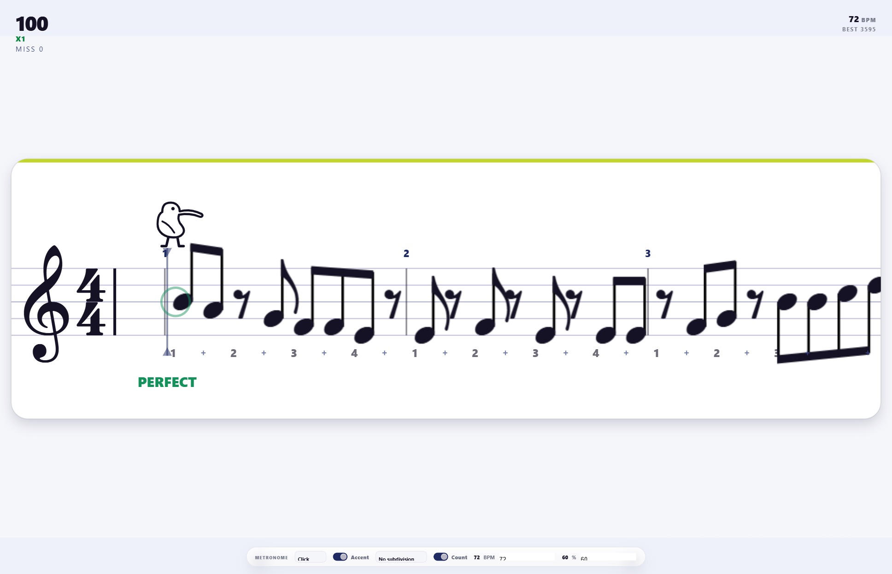

# Rhythm Flap

A one-button sight-reading game. The staff is the playfield, a bird flies above
it and lands on each note as it crosses the line, and the only input is tapping
(and holding) in time.

Created by **Ray Foo** · [www.rayfooproductions.com](https://www.rayfooproductions.com)



## Quick start

```bash
npm install
npm run dev      # http://localhost:5173
npm test         # 57 Vitest tests
npm run build    # type-check + production build in dist/
npm run preview  # serve the production build
```

## Controls

| Action | Input |
| --- | --- |
| Start / hit the note at the line | `Space`, click, or tap |
| Hold a sustained note | keep `Space` (or the pointer) down for the note's value |
| Choose a starting tier | `1`–`9`, arrows, or click a card |
| Pause | `P` (also pauses when the tab is hidden) |
| Retry the same course | `Space` on the result screen |
| New random course | `R` on the result screen |
| Back to tiers | `Esc` |

## How it plays

- Notes scroll right-to-left at the current tempo. The bird flies in a band above
  the staff and hops from note to note, touching down on each note's perch exactly
  on its beat — you never control height, and the notation stays clear.
- Tap as the note crosses the line. Timing windows: **PERFECT ≤ 80 ms**,
  **GOOD ≤ 150 ms**, **OK ≤ 280 ms**; anything else, or an untouched note, is a
  **MISS**.
- **Long notes are sustained.** A note longer than an eighth is pressed and held
  for its written value. Releasing early is **TOO SHORT**, holding through a rest
  is **TOO LONG**, and a clean release adds **+25**.
- Points: `100 / 50 / 20` for PERFECT / GOOD / OK, times the combo multiplier
  (1×, then +0.5× every five hits, capped at 3×). Any miss resets the combo.
- **Mistakes never end the run.** A run is eight bars, and the result screen reports
  **accuracy** (`hits / (hits + misses)`), notes hit, best combo and top tempo.
- Every 8 hits the tempo rises by 5 BPM (cap 184).

## Notation

The score is engraved by **VexFlow** with **Bravura** — the same engine and font
OpenSheetMusicDisplay uses — while staying pinned to the beat grid:

- Each measure is rendered once to a cached canvas and blitted as it scrolls, so
  VexFlow's engraving is exact but the timing stays sample-accurate.
- Off-beat notes that cross a beat are **split at the beat and tied**; rests split
  the same way. On-beat dotted values keep their written form.
- Eighths are beamed in **half-bar groups** in 4/4; rests, longer values, ties and
  bar lines break the beam.
- Stems point **down on and above the B line** and up below it; a beam takes the
  direction of its note farthest from the middle line.
- Treble clef and 4/4 at the system start, a bar line and number per measure, and
  a hit line at the bird.
- The **Count** switch draws the counting under the notes, beneath the stave:
  beat numbers (`1`, `2`, `3`, `4`) on the beat and `+` on the offbeat, e.g.
  `1 + 2 + 3 + 4 +`.

## Metronome

The bar at the bottom of every exercise carries:

| Control | Options |
| --- | --- |
| Tempo | 60–180 BPM, applied live |
| Volume | 0–100 %, on its own audio bus |
| Sound | Click, Beep, Wood, Digital |
| Accent | higher, louder downbeat |
| Subdivision | Off, 8ths, Triplets, 16ths — quiet clicks between beats |
| Count | count row under the stave |

The pause panel repeats tempo and volume. All settings persist, and the
metronome volume never affects note, miss or crash sounds.

## Theme

The palette is the **Lakeland Senior High School** one (navy / green / lime) from
the *Rhythm Quiz — Complete the Bar* design reference. Values live in two places,
because canvas code cannot read CSS variables:

- `src/styles.css` — the `:root` tokens the HTML UI uses.
- `src/game/render.ts`, `notation.ts`, `score.ts` — the same hexes as canvas
  constants (card, staff, notation ink, feedback).

| Role | Hex |
| --- | --- |
| Text and notation ink | `#161226` |
| Page / card | `#f5f6fa` / `#ffffff` |
| Muted text | `#6b6f80` |
| Borders | `#e2e5ee` |
| Brand navy — hit line, bar numbers, primary UI | `#202b64` |
| Brand navy light — secondary, off-beat counts | `#3d4a94` |
| Logo green / lime rule | `#0a8440` / `#c1d52d` |
| Staff lines | `#c9c6dd` |
| PERFECT / HELD / MISS | `#15915b` / `#0d9488` / `#c23b52` |

No web fonts: the UI uses the platform UI stack and the notation uses the bundled
Bravura font, so the app still runs offline.

## Starting tiers

| # | Name | Start BPM | Durations | Rests | Ties | Syncopation |
| --- | --- | --- | --- | --- | --- | --- |
| 1 | Eighths & Rests | 72 | ½ | ½ | – | – |
| 2 | Eighths & Ties | 76 | ½ | – | ✓ | ✓ |
| 3 | Eighths, Rests, Ties | 80 | ½ | ½ | ✓ | ✓ |
| 4 | Unsyncopated Mix | 84 | ½, 1 | ½ | – | – |
| 5 | Quarters, Eighths & Ties | 88 | ½, 1 | ½ | ✓ | ✓ |
| 6 | Dotted Notes | 92 | ½, 1, 1.5 | ½ | – | ✓ |
| 7 | Dotted Notes & Ties | 96 | ½, 1, 1.5 | ½ | ✓ | ✓ |
| 8 | Dotted Rests | 100 | ½, 1, 1.5 | ½, 1.5 | – | ✓ |
| 9 | Master Rhythm | 108 | ½, 1, 1.5 | ½, 1.5 | ✓ | ✓ |

The tier sets the duration vocabulary and default starting tempo; the metronome
slider can override the tempo.

## Seeded courses

A course is fully determined by `?tier=<1-9>&seed=<slug>`, and the current seed is
shown in the menu. A URL with `share=1` opens that course and waits for a tap;
`R` on the result screen rolls a new seed.

## Audio

Everything is synthesised with oscillators — no samples:

- **Hitting a note plays that note's pitch** (E4–F5, triangle) for its written
  value; held notes sustain until you release.
- Metronome clicks are generated per style (square/sine/triangle), with an
  optional accent and optional subdivision clicks.
- Miss: short 180 Hz square. End of run: 150 Hz sawtooth with a 90 Hz tail.

## Data

Everything is local; there is no backend or account.

| Key | Contents |
| --- | --- |
| `rhythmFlap.v2` | best score per tier, last tier |
| `rhythmFlap.settings.v1` | tempo override, metronome volume, count, style, accent, subdivision |

## Project structure

```
src/
  main.ts            DOM wiring, input, loop, overlays, settings
  fonts.ts           loads bundled Bravura and points VexFlow at it
  styles.css         theme, HUD, menus, metronome bar
  fonts/             Bravura.otf + OFL licence
  game/
    types.ts         Tier, NoteEvent, Phase, BirdState, Grade
    rng.ts           mulberry32 + seed hashing
    tiers.ts         the nine starting tiers
    layout.ts        4/4 generator, course, staff geometry, PX_PER_BEAT
    world.ts         playfield constants
    rhythm.ts        engrave() and beamGroups()
    score.ts         VexFlow per-bar engraving, caching, ties
    notation.ts      clef/4-4, count labels, notation entry point
    scoring.ts       timing windows, combo, timingScore
    engine.ts        run state, tap/hold judging, misses, tempo ramp, finish
    audio.ts         Web Audio buses, metronome styles, note playback
    render.ts        letterboxed canvas renderer (card, staff, bird, popups)
    storage.ts       bests, last tier, settings
tests/               Vitest suites for the pure layers
docs/                build plan, architecture, testing, decisions, changelog
```

## Documentation

- [Build plan](docs/BUILD_PLAN.md) — scope, milestones, status, next steps.
- [Architecture](docs/ARCHITECTURE.md) — timing, engraving pipeline, audio, storage.
- [Testing](docs/TESTING.md) — automated coverage and manual QA.
- [Decisions](docs/DECISIONS.md) — why VexFlow, per-bar caching, no fail state.
- [Changelog](docs/CHANGELOG.md) — what changed, release by release.

## Known limitations

- 4/4 and a treble clef only.
- The VexFlow bundle is ~1.15 MB; Vite warns about the chunk size.
- Count labels appear only at rhythm events, not as a continuous grid.
- No MIDI input, recording, backing tracks or cloud sync.

## Credits

Created by **Ray Foo** · [www.rayfooproductions.com](https://www.rayfooproductions.com).

Bravura is licensed under the SIL Open Font License (see `src/fonts/OFL.txt`).
VexFlow is MIT licensed.
